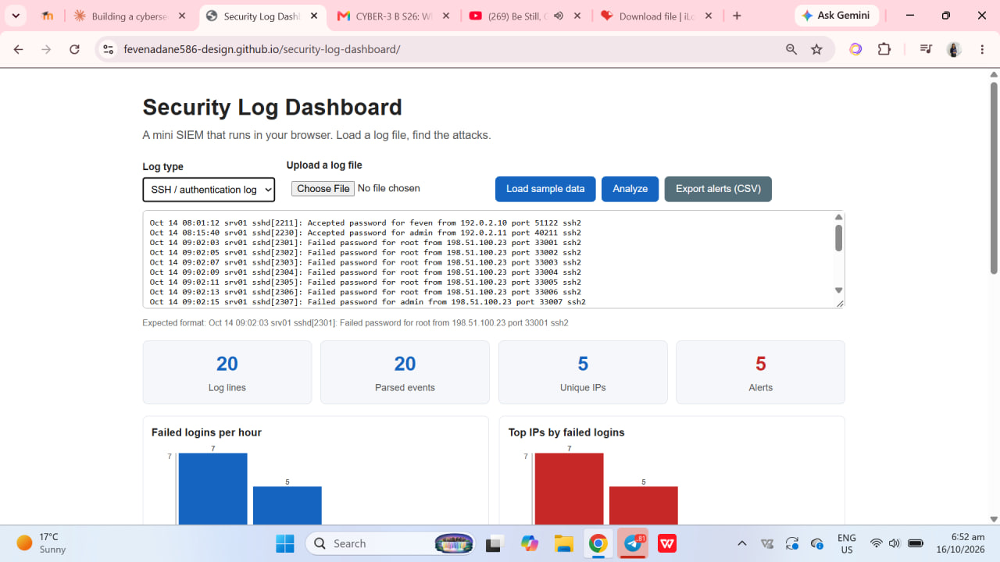
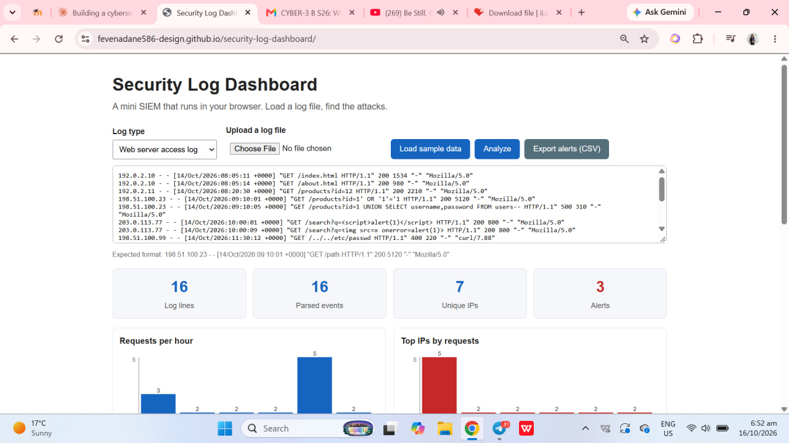
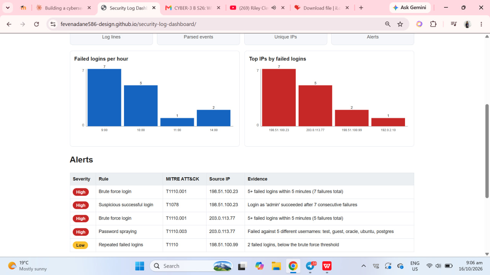

# Security Log Dashboard

A browser-based mini SIEM. It parses SSH authentication logs and web server access logs, detects common attacks, draws charts, and maps each alert to a MITRE ATT&CK technique. Built with plain HTML, CSS and JavaScript. No libraries, no server: logs are processed locally in the browser.

**Live demo:** https://fevenadane586-design.github.io/security-log-dashboard/

## Screenshots

### SSH authentication log analysis

### Web server log analysis

### CSV export

## Features

- Parses SSH auth logs and Apache/Nginx-style access logs
- Seven detection rules with severity levels and MITRE ATT&CK mapping
- Charts drawn with plain SVG: activity per hour and top source IPs
- Alert table sorted by severity
- CSV export of alerts (with protection against spreadsheet formula injection)
- Upload a file, paste lines, or load built-in sample data

## Detection rules

| Rule | Logic | MITRE ATT&CK |
|---|---|---|
| Brute force | 5+ failed logins from one IP within 5 minutes | T1110.001 |
| Password spraying | One IP failing against 4+ different usernames | T1110.003 |
| Suspicious success | Successful login after 3+ consecutive failures | T1078 |
| SQL injection | SQL keywords and tautologies in requests | T1190 |
| Cross-site scripting | Script tags and event handlers in requests | T1190 |
| Path traversal | `../` sequences and system file paths | T1083 |
| Scanner activity | Known scanner user agents, or many 404s | T1595 |

## How it works

1. **Parse:** regular expressions turn raw log lines into structured events (time, IP, user, status, path).
2. **Group:** events are grouped per source IP.
3. **Detect:** each rule checks the grouped events using thresholds and time windows.
4. **Report:** alerts are rendered in a table, charts show the activity, and alerts can be exported.

Log data is always inserted with `textContent`, never as HTML, so a malicious log line cannot run code in the dashboard. This applies the XSS lesson from my Web Security Lab project.

## What I learned

- How SIEM-style detection works: parsing, correlation, thresholds and time windows
- The difference between brute force and password spraying
- How to map detections to MITRE ATT&CK
- Why log data must be treated as untrusted input
- How to draw charts with SVG without a library

## Limitations

- Rules use fixed thresholds, so they will miss slow attacks and can produce false positives
- Only two log formats are supported
- Sample IPs come from reserved documentation ranges and the data is fictional
- Educational project, not a replacement for a production SIEM

## Future improvements

- IP geolocation and threat intelligence lookups
- Windows Event Log support
- Adjustable thresholds
- Timeline view of an incident

## License

MIT
